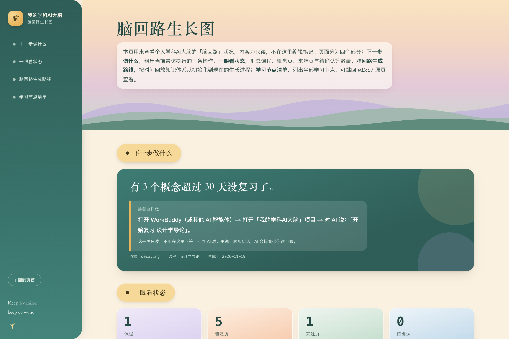
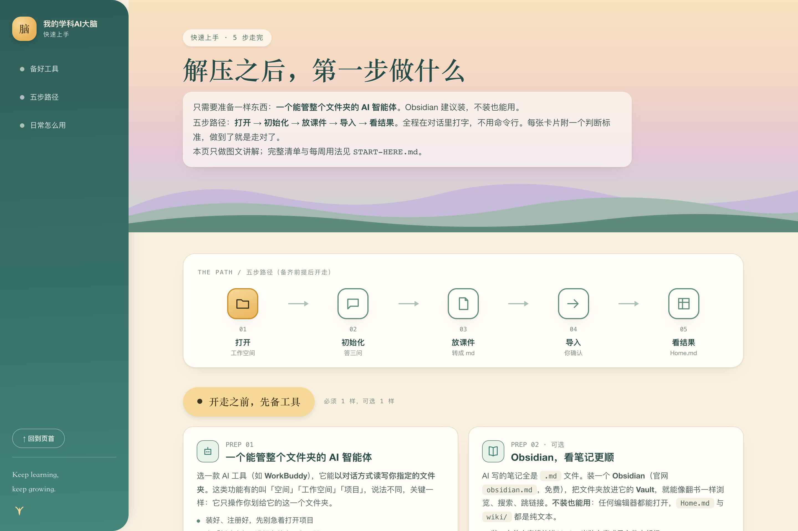

# 我的学科AI大脑

> **简称：学科AI大脑**（简称必须带 AI）
> 课件放进去，AI 帮你把知识点连成网、记住你哪里没懂、考前只挑你的薄弱处出题。同一份课件，每个人长出的都不一样——因为这次长的，是你自己的学科AI大脑。

**口号**：同一间教室，长出不一样的学科AI大脑。

---

## 📌 当前状态（重要）

模板层（`AGENTS.md` / `skills/` / `commands/` / `docs/`）**不含任何学科内容**，装进去的才是你的学科。

- 想开始用：说「**初始化**」填写 `config.md`，再按 `START-HERE.md` 导入第一份课件 md
- **不知道现在做什么 / 想看知识体系怎么长出来**：打开项目根的 `脑回路生长图.html`：「下一步做什么」给出当前该做的一件事，「一眼看状态」汇总数量，「脑回路生成路线」可播放进化路径与知识图谱；也可直接说「下一步」
- 想直接看首页：打开 `Home.md`
- 手上副本若带 🧪 演示数据（课程、概念页都是样例），说「**清空测试数据**」即可复位为空白模板，清单见 `docs/FAQ.md`「测试与清理」节

> 换一门课不需要改底座；学科差异唯一来源是 `config.md` 的 `course_name` 与 `subject_hint`。

## 🖼 看看它长什么样

**脑回路生长图**（点击图片查看整页）：

**快速上手**（点击图片查看整页）：

---

## 👩‍🏫 教师版：怎么让一个班用起来

### 发一次就够了

> **分发、版本升级与历史版本保管由图书馆负责**；教师只做教学侧动作与使用情况反馈。

1. 图书馆打包为带版本号的 ZIP（当前 `我的学科AI大脑_v2.00.zip`），发布到校内版本页 / GitHub Releases 并留存 hash 清单与历史版归档
2. 教师在课程页放同一个链接（全班**同一个文件、同一个版本号**）
3. 课上用 10 分钟演示前 5 步（见 `START-HERE.md`）
4. 布置一次作业：「把这周课件转成 md 后导入，看看首页出现什么」
5. 有操作 / 实验类任务时提醒一次：「说『实践』，把步骤和现象记下来；课件没写的报错会标注需课堂确认」
6. 期中/期末提醒一次：「说『出题』，练自己的薄弱点」
7. 期末把使用情况反馈给图书馆，双方共商下一版改动

### 三条教学边界（请写进课程说明）

- **不收笔记**：学生 `wiki/` 留在本机，教师不查看、不收集
- **不比较**：不设统一标准答案页，不要求全班结构一致
- **不排名**：`confidence` 是学生个人掌握度，不是成绩

教师确认「用起来了没有」，提供课件授权、学科写法卡与课堂疑问裁定，并把使用情况反馈给图书馆。版本发布、升级与保管由图书馆执行，见 `docs/升级指南.md`。

### 多门课怎么用

**不用复制仓库、不用开分支。** `raw/{课程名}/` 每门课一个子文件夹；「预习 / 复习 / 出题」由学生自己带课程名限定，可指定一门或多门课；「实践」按一门课分别记录、不跨课混写。`config.md` 仍是单值，换主线改两行即可。

完整口径见 `docs/多课程使用说明.md`（唯一操作权威）；教师侧分工见 `docs/教师发放指南.md`。

---

## 🎓 学生版：5 分钟上手

> 完整分步讲解与判断标准见 `START-HERE.md`（学生上手的权威页）；这里是速览。

1. 解压，用 AI 工具**打开这个文件夹作为工作空间**
2. 说「**初始化**」，回答三个问题（课程名？中文还是双语？**这门课想达到什么目标？**）；其余字段用默认值，学科写作偏好可留空
3. 先把课件转成 `.md`（见 `docs/材料准备指南.md`），再把第一份拖进 `raw/{课程名}/`
4. 说「**导入**」，确认一下 AI 提炼的要点
5. 打开 `Home.md`，看到自己的第一页笔记

> 「学科」＝你这学期在学的任何一门课，不限专业。
> 这是你自己的学科AI大脑：**不收交、不比较、数据留在本机**。

**想先入门、还不想背**：导入过材料后说「**预习**」。它只讲材料里写了的内容，把新知接在你已有的概念上；材料没写的，它不补、不猜、不联网，并建议补材料或课上问老师。

**有操作 / 实验类任务**：做的时候说「**实践**」，把步骤、看到的现象和报错原样记下来。课件没写的报错，AI 只给通用排查思路，并逐条标注「非课件内容，需教师确认」——带到课堂向老师确认后再用；实践记录不影响你的掌握度。

### 命令速查

| 说这句话 | 会发生什么 |
|---|---|
| `导入 raw/{课程名}/L1-主题.md` | 课件 md 变成来源页 + 概念页 + 课程总览 |
| `预习 {课程名}` | 材料盘点 → 只凭材料引导 → 把新知挂到你已有的概念上；你确认的理解才入库 |
| `复习 {课程名} 第三章` | AI 费曼式提问，**你作答**后更新个人掌握度 |
| `出题 {课程名}` / `出题 {课程名A} + {课程名B}` | 只挑你自己的薄弱概念生成练习题（不附答案） |
| `实践 {课程名}` | 逐步记录操作、现象与问题；课件没写的报错只给通用排查思路，逐条标注需课堂确认 |
| `体检` | 检查断链、孤岛、配置、底座、数据层是否被污染 |
| `配图` | 给概念页补 Mermaid 图（可选） |
| `升级` | 只换共同底座，**不动你的任何笔记** |
| `迁移` | 仅当 `CHANGELOG.md` 给出格式迁移说明时，经你确认调整 `wiki/` 页面格式 |
| `清空测试数据` | 按 `docs/FAQ.md`「测试与清理」节清单复位为空白模板（先确认、先备份） |
| `强制重做` | 对一份已导入材料重新编译，保留你已写的「我的理解」 |

`初始化` 见上一步。其余命令里，`迁移` / `清空测试数据` / `强制重做` 是维护命令，平时用不到；`升级` 只在换版本时用；其余是日常命令。触发词的唯一权威表在 `AGENTS.md`「命令映射」表（共 12 个）。
课程名是**限定语**，不是新命令；可指定一门或多门课，范围规则见 `docs/多课程使用说明.md`。
也可以直接说人话：「把这周课件放进知识库」「考前给我练几道题」。

---

## 🧩 目录各管什么

| 目录 | 职责 | 谁在写 |
|---|---|---|
| `raw/` | 只放课件 md；只读，引用回溯的原始依据 | 学生放，AI **永不修改** |
| `wiki/` | 长出来的、只属于这个学生的学科AI大脑 | AI 编译，学生审校 |
| `wiki/preview/` | 预习轨迹 + **你本人**确认的理解、总结、自得结论、保留疑问 | 学生确认后，AI 局部写入 |
| `wiki/practice/` | 你的操作步骤、现象与问题的真实记录（独立一支） | 学生原话，AI 照录 |
| `skills/` | 一套操作规则，无场景分支 | 模板层，可升级 |
| `commands/` | 中文触发词 → 对应 skill | 模板层，可升级 |
| `config.md` | 个性化设置入口，决定「按谁的方式长」 | 学生，🟢 自由改 |
| `examples/` | 可运行样板 + AI 的格式参考 | 模板层，可升级 |
| `docs/` | 路径与边界；含 `材料准备指南.md`、`多课程使用说明.md`、`图书馆资源服务指南.md`、`FEEDBACK.md` 与 `PRECHECK.md` | 模板层，可升级 |
| `docs/本馆资源获取指南.md` | 馆员填写的本馆资源获取表（**校本数据**） | 图书馆填写，升级**永不覆盖** |
| `Home.md` | 纯 Markdown 首页（**两对**模板区可升级，静态清单不动） | 两者 |

> **四类内容必须分开**：目录是写入契约、配置项是行为、示例内容是样板、使用说明是边界。混在一起会让升级覆盖学生数据。

---

## 🔧 用 Obsidian 打开（可选）

不装 Obsidian 也能用：`Home.md` 与 `wiki/` 都是纯 Markdown，任何编辑器都能看。想用 Obsidian 时按这几条放：

1. **整个项目文件夹放进 Vault**：项目可以是独立 Vault，也可以是某个 Vault 里的子文件夹；是子文件夹时不生成 `.obsidian/`，沿用 Vault 根目录已有的配置
2. **AI 工具打开项目文件夹本身**：`AGENTS.md` 在项目根，只有把这一层作为工作空间才会被自动读取；Vault 根的 `.claude/` / `.agents/` 作用于整个库，本项目规则在项目内
3. **Dataview 用标签式查询**：写 `FROM #concept`，不写路径式 `FROM "wiki/concepts"`，子文件夹与改名都不受影响
4. **概念页用英文名**：双向链接在整个 Vault 内可用，英文名降低重名冲突
5. **Dataview 是可选增强**：不装插件，`Home.md` 的静态清单也完整可用

---

## ⚠️ 使用提醒

- **AI 停下来是在等你确认，不是卡住**：导入时它会先给要点并停下，回「确认」才生成笔记
- AI 生成内容可能有误，**不替代听课与教材**；引用前回溯 `wiki/sources/` 中的课件 md
- **写法有统一风格**：页面正文按 STE 80% 写（一句一事、主动语态、一词一义），流程与对比类内容配 Mermaid 图并注明来源。想调松或调严，说「风格太硬」或「有歧义」，细则见 `docs/风格约束.md`
- **材料前提**：PDF / PPT / doc 先在项目外转成 md，本人核对后再放进 `raw/`；原件不进 `raw/`，也不用在线转换服务上传课件
- 「我的」也意味着**你要为自己的理解负责**：AI 负责编译，理解由你完成
- 禁止上传涉密或未授权资料
- 课件仅用于本班教学，请确认授权

---

## 版本与来源

v2.00 · MIT · 起点 `IssacW228/student-llm-wiki`
详见 `CHANGELOG.md`、`ATTRIBUTION.md`、`LICENSE`。
ZIP 发布、版本升级与历史版本保管由图书馆执行；教师反馈使用情况，双方期末共商版本改动。见 `docs/升级指南.md` 与 `docs/FEEDBACK.md`。

> **获取**：本项目的 `Releases` 页提供带版本号的 ZIP（如 `我的学科AI大脑_v2.00.zip`）与 SHA-256 校验值，源码在 `main` 分支。学生用 ZIP 解压后说中文口令即可使用，**无需 Git、无需命令行**。
