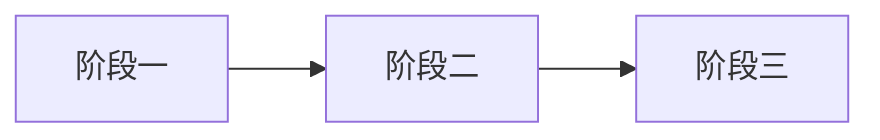
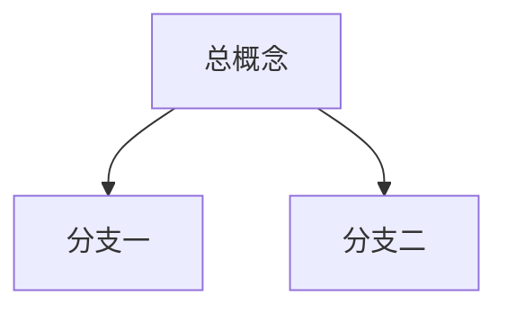

# 配图 — wiki-diagram

> v0.1 可选能力。是否配图先看 `config.md` 的 `subject_hint`：若其中要求「流程优先用 Mermaid 图」，导入时对相关概念主动配图。

## 判断标准

适合配图：流程 / 阶段划分 / 框架结构 / 分类树 / 时序关系 / 对比矩阵
不适合：纯定义、单一概念、以文字论述为主的内容

## 规则

1. 图放在概念页「图解 Diagram」章节，用 Mermaid 代码块
2. 一张图只表达一个关系，节点 ≤8 个
3. 节点文字用中文（`language: 纯英文` 时用英文）
4. **局部插入**，不重写整页
5. 图下方补一句「怎么读这张图」，并注明它来自哪份来源页
6. 不得凭空添加源文件里没有的环节

## 常用模板

> 配图是辅助理解的，**不能替代**概念页的直觉解释。
